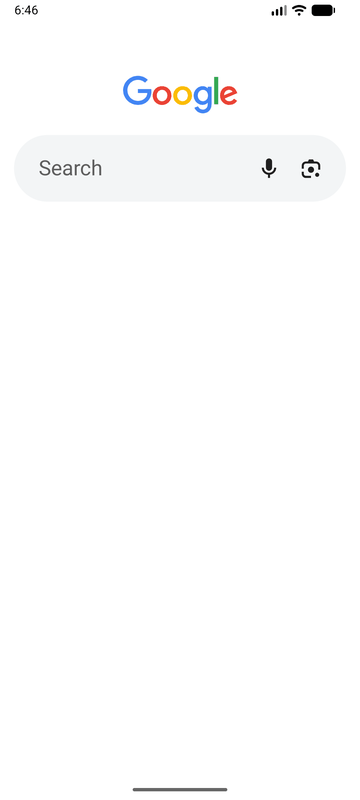
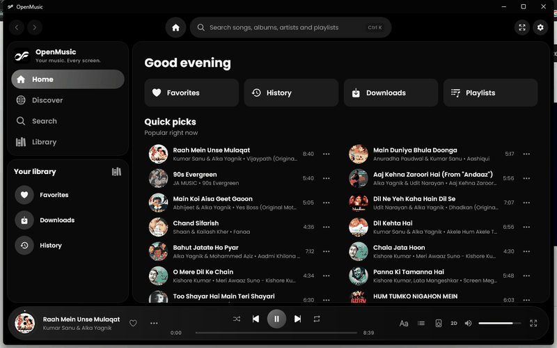
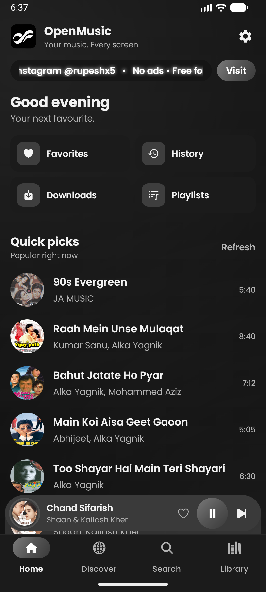
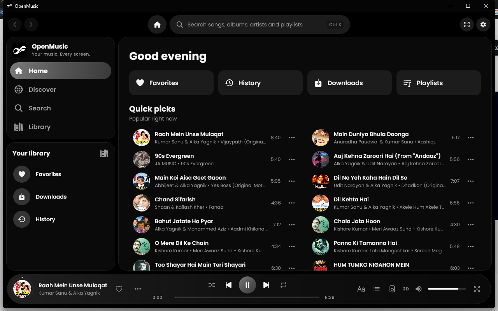

<div align="center">
  
  <h1>OpenMusic</h1>
  <p><b>Your music. Every screen.</b><br/>A free, ad-free music player for Android and Windows.</p>

  <a href="https://github.com/Rupesh9369/OpenMusic/releases/latest"></a>
  <a href="https://github.com/Rupesh9369/OpenMusic/releases/latest"></a>
  <a href="https://github.com/Rupesh9369/OpenMusic/releases"></a>

  <p>
    
    
    
    
    
  </p>

  <p><a href="https://rupeshh.pages.dev">rupeshh.pages.dev</a> · <a href="https://www.instagram.com/rupeshx5/">Instagram: @rupeshx5</a></p>
</div>

---

## Preview

<p align="center">
  
  &nbsp;&nbsp;
  
</p>

## Screenshots

| Android | Windows |
| --- | --- |
|  |  |

Frames for the previews are in [`docs/assets/frames-android`](docs/assets/frames-android) and [`docs/assets/frames-windows`](docs/assets/frames-windows).

## Download

Downloads are on the [Releases page](https://github.com/Rupesh9369/OpenMusic/releases/latest).

- **Android:** open the APK on your phone and allow *Install unknown apps* for your browser.
- **Windows:** run `OpenMusic-Setup-x.y.z.exe`. It is not code-signed yet, so Windows may show *Protected your PC*. Click **More info → Run anyway**.

## Features

- **Two catalogues, one player:** YouTube Music first, JioSaavn as a second source and automatic fallback.
- **Local music:** plays songs from your device (Android) or from your PC (Windows). The folders are `Music/K4 Audio` on the phone and `Music\K4 Audio` on the PC.
- **Downloads** for offline listening, with streaming quality from *Data saver* to *High*.
- **Playlist import** from Spotify and YouTube Music links.
- **Audio effects:** 10-band equalizer with presets, bass boost, wide stage, reverb, loudness normalization, pitch and skip silence.
- **Spatial audio:** 2D (normal), 3D (wider), 8D and 16D (the sound moves around your head). Changes apply to the song that is playing.
- **Lyrics**, including synchronized lyrics.
- **Discord status** on Windows (shows OpenMusic and the song you are playing).
- **Phone to PC transfer** over your Wi-Fi, encrypted, with no server in between.
- **Pure Glass**, Blurred Artwork and other background styles on Windows.
- **Updates from a JSON file:** a popup tells you when a newer version is out, with **Update** and **Skip** buttons.

## How it works

```
 +-------------------+        +----------------------+        +-------------------+
 |  Android app      |        |  Windows app         |        |  GitHub repo      |
 |  (Compose, Media3)|        |  (Compose Desktop,   |        |  update-android   |
 |                   |        |   libmpv)            |        |  update-windows   |
 +---------+---------+        +----------+-----------+        +---------+---------+
           |                             |                              |
           |   search / play             |   search / play              |
           v                             v                              |
 +-------------------------------------------------------------+        |
 |  Providers: YouTube Music (Innertube), JioSaavn,            |        |
 |  lyrics (LRCLIB), SponsorBlock, Discord RPC                 |        |
 +-------------------------------------------------------------+        |
           |                                                            |
           |   on start and every few hours: read the JSON  <-----------+
           v
   popup: Update  -> opens the Releases page
          Skip    -> hides that version
```

### Playback flow

1. You pick a song from search, Home, a playlist or Local music.
2. The app stores it in the local database (Room) and adds it to the queue.
3. The stream is resolved: YouTube through the Innertube API, JioSaavn as a fallback. On Windows, `yt-dlp` gives the audio URL.
4. The audio is played by Media3 / ExoPlayer on Android and by libmpv on Windows.
5. Effects (equalizer, bass, wide stage, reverb, spatial mode) are applied as an audio processor chain (Android) or an mpv filter chain (Windows).
6. Play history, favorites and lyrics are saved to the local database.

### Update flow

1. On start (Windows) or when Home opens (Android), the app downloads its JSON file from `raw.githubusercontent.com/Rupesh9369/OpenMusic/main/`.
2. It compares the file's `version` with its own version, part by part.
3. A newer version shows the popup. **Update** opens the Releases page; **Skip** remembers that version.
4. The download link is only accepted when it starts with `https://github.com/Rupesh9369/OpenMusic/releases`.

## Tech

| Area | Android | Windows |
| --- | --- | --- |
| Language and UI | Kotlin, Jetpack Compose | Kotlin, Compose Multiplatform for Desktop |
| Playback | Media3 / ExoPlayer with custom audio processors | libmpv (mpv) with an FFmpeg filter chain |
| Stream extraction | YouTube Innertube API | `yt-dlp`, QuickJS for YouTube challenges |
| Storage | Room database | Room (SQLite) |
| Lyrics | LRCLIB | LRCLIB |
| Packaging | Gradle, signed APK | Gradle, Inno Setup installer |

Shared Kotlin modules live in `core/`, `compose/`, `providers/` and `ktor-client-brotli/`.

## Build from source

You need JDK 21 and, for Android, the Android SDK.

**Android (debug APK):**

```
./gradlew :app:assembleDebug
```

**Windows (run the app from source):** put the native tools in `windows/downloads/` (see [windows/README.md](windows/README.md)), then:

```
./gradlew -p windows run
```

**Windows installer:**

```
./gradlew -p windows packageInstaller
```

The installer is written to `windows/build/installer/`.

Release builds need a signing keystore (see `app/build.gradle.kts`).

## Update files

| File | Used by |
| --- | --- |
| [`update-android.json`](update-android.json) | Android app |
| [`update-windows.json`](update-windows.json) | Windows app |

Each file has `title`, `version`, `description`, `download_url`, `update_label` and `skip_label`. Set `download_url` to the Releases page. To publish an update, raise `version` and push the file to `main`.

## Credits and license

OpenMusic is built on [ViTune](https://github.com/25huizengek1/ViTune) (player, providers and UI), with additions for JioSaavn, audio effects and the Windows app. See `LICENSE` for the upstream copyright notices.

Licensed under the [GNU General Public License v3.0](LICENSE).

This project is not affiliated with YouTube, Google LLC, Spotify, JioSaavn or Discord.
